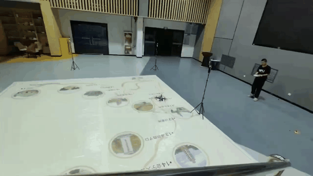

# 无人机自主穿框与室内飞行 Demo

面向室内无人机自主飞行的项目记录，包含基于 ROS、PX4、Gazebo 的视觉穿框仿真，以及真机飞行演示。

## 真机飞行 Demo

**[▶ 在线播放完整视频（约 31 秒，无需下载）](https://wangxt888.github.io/drone-gate-demo/)**

视频记录室内起飞、飞行与降落过程；此片段不展示穿框。

## 项目内容

- **视觉穿框仿真**：单目 RGB 检测与 PnP 位姿估计，完成搜索、对准、穿越及终点降落流程。
- **定位与控制**：模拟动捕定位接入 MAVROS / PX4，使用状态机组织飞行任务。
- **场景搭建**：基于共享几何定义生成 Blender 场景与 Gazebo 模型。

本仓库以 Demo 展示为主。
